<div align="center">

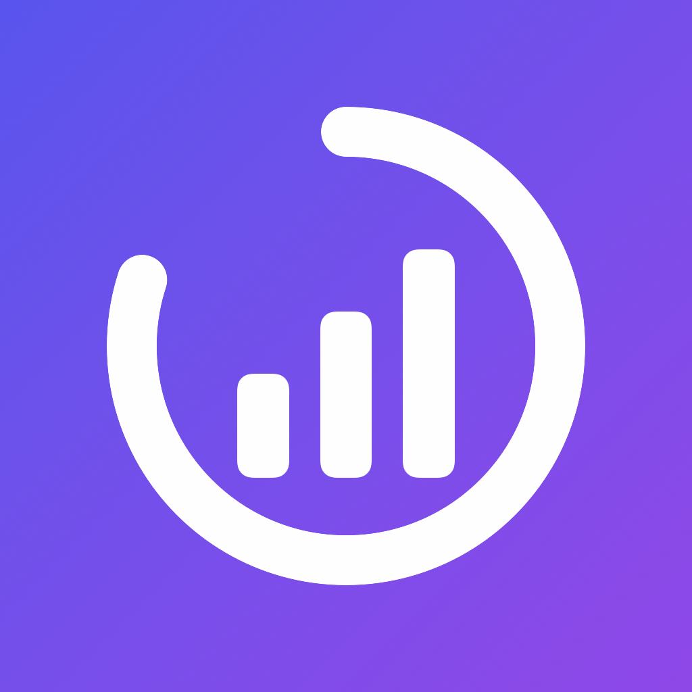

# Bandwise

**A complete IELTS Academic coach for iPhone — that runs entirely on your phone.**

Practice all four skills, get your writing and speaking marked, learn grammar and vocabulary,
and follow a daily study plan. No account, no subscription, no internet needed.


</div>

---

## Contents

- [What's inside](#whats-inside)
- [Screenshots](#screenshots)
- [Install on an iPhone from a Mac](#install-on-an-iphone-from-a-mac) — 9 steps, about 30 minutes the first time
- [Install on an iPhone from Windows](#install-on-an-iphone-from-windows) — 8 steps
- [How it works](#how-it-works)
- [Project structure](#project-structure)
- [Rebuilding the data and models](#rebuilding-the-data-and-models)
- [Testing](#testing)
- [FAQ and troubleshooting](#faq-and-troubleshooting)
- [Data sources and credits](#data-sources-and-credits)

---

## What's inside

| | Module | What you get |
|---|---|---|
| 🎧 | **Listening** | Everyday conversations and **421 academic lectures**, played once like the real test, with form completion and multiple-choice questions |
| 📖 | **Reading** | **1,051 practice tests** (14,188 questions, 7 question types) — every answer shows the evidence sentence, an explanation and how the question paraphrased the text. **263 full 40-question papers** |
| ✍️ | **Writing** | **120 Task 1 visuals** (charts, tables, maps, processes) and **400 Task 2 questions**. Your answer is marked on the phone with bands for all four criteria, highlighted mistakes and a high-band sample to compare |
| 🎙️ | **Speaking** | Full 3-part mock test with a spoken examiner, **149 cue cards**, **181 Part 1 topics**, a conversation partner and **88 real test transcripts** from band 3.5 to 9 |
| 📐 | **Grammar** | A **61-unit IELTS grammar course** (B1–C1) with rules, form tables, common mistakes and 400 interactive questions — every unit marked **Essential / Important / Useful for IELTS**. Plus the Mentors' *Foundation Grammar & Writing* book with its exercises |
| 🔤 | **Vocabulary** | **9,485 words** (A1–C2) with meaning, pronunciation, real academic examples and synonyms. Flip flashcards, quizzes, listen-and-spell and a matching game, with spaced repetition |
| 🎓 | **Tutor** | A personal **study plan** built from your test date and weakest skill, **4 daily tasks**, and a **25-lesson IELTS strategy course** |
| 📚 | **Exam practice** | A companion for **Cambridge IELTS books 1–21**: timed answer sheets, automatic marking from your book's key, band conversion and a question-type mistake tracker |
| 📈 | **Progress** | Band trends per skill, streaks, XP and a daily goal |

### Highlights

- **Marked on the device.** A writing scorer trained on ~7,000 IELTS essays runs through Core ML; a rule engine adds evidence, IELTS caps (word count, Task 1 overview) and corrections. Speech is transcribed on the phone.
- **Honest scores.** Every band comes with a note on how far it can be trusted. On held-out examiner-scored essays the scorer is within half a band 60% of the time and within one band 86% of the time.
- **Interactive everywhere.** Tap-to-answer chips, word tiles, tap-the-mistake, flashcards with swipe, timed papers, confetti when you do well.
- **Private.** Nothing leaves the phone. Your history is stored locally.

---

## Screenshots

| Home | Learn | Grammar course | Grammar unit |
|:---:|:---:|:---:|:---:|
| 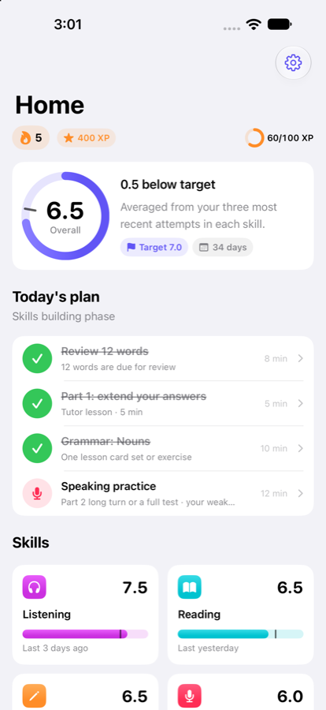 |  | 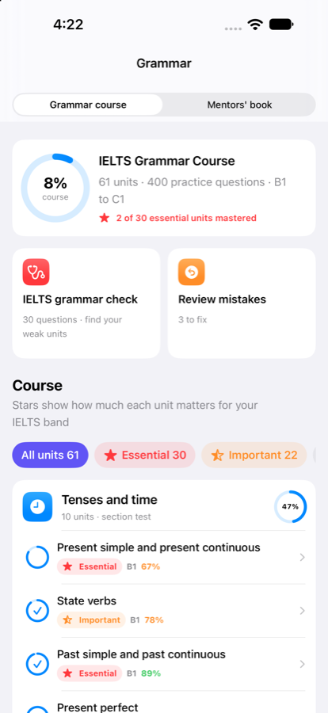 | 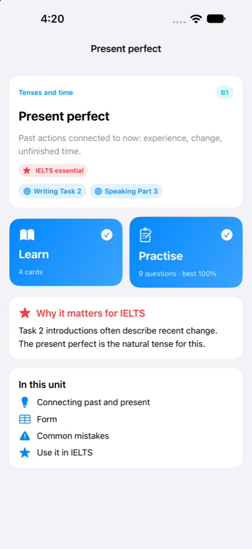 |

| Lesson card | Find the mistake | Vocabulary | Flashcards |
|:---:|:---:|:---:|:---:|
| 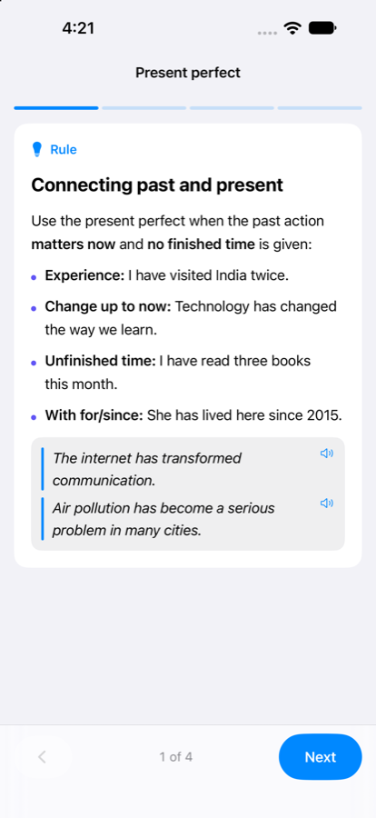 | 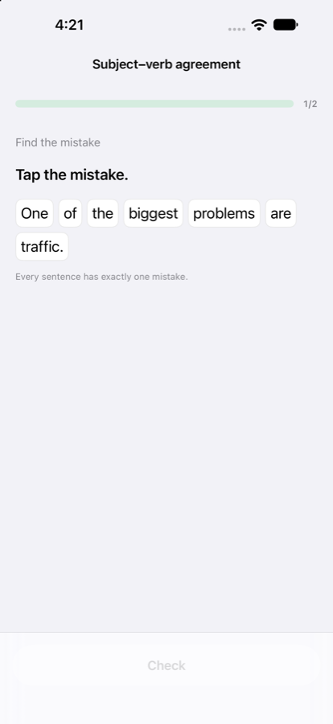 | 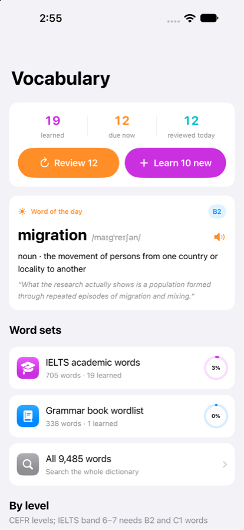 | 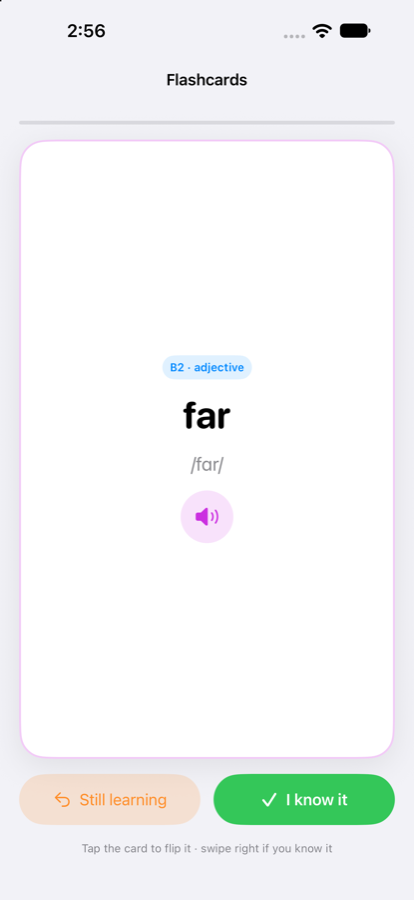 |

| Tutor | Reading test | Writing Task 1 | Cambridge companion |
|:---:|:---:|:---:|:---:|
| 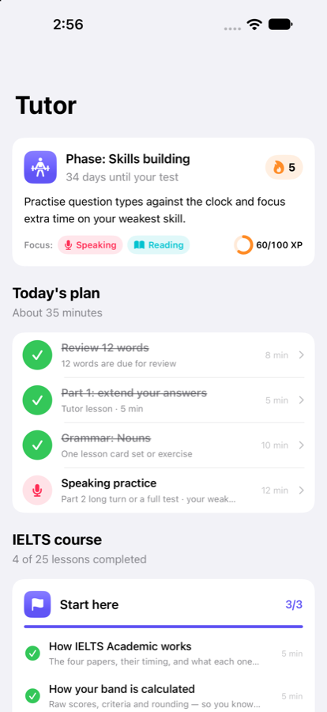 | 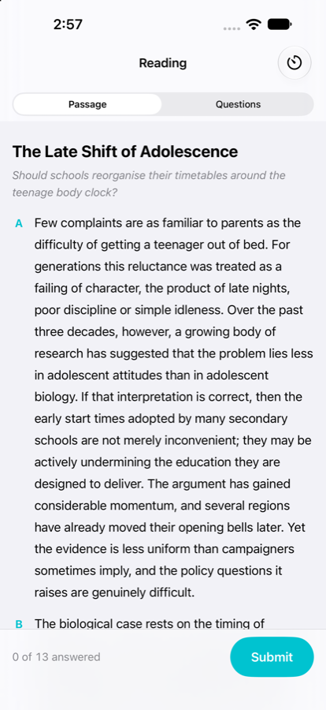 | 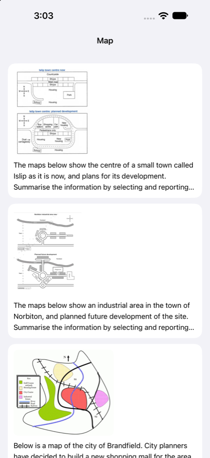 | 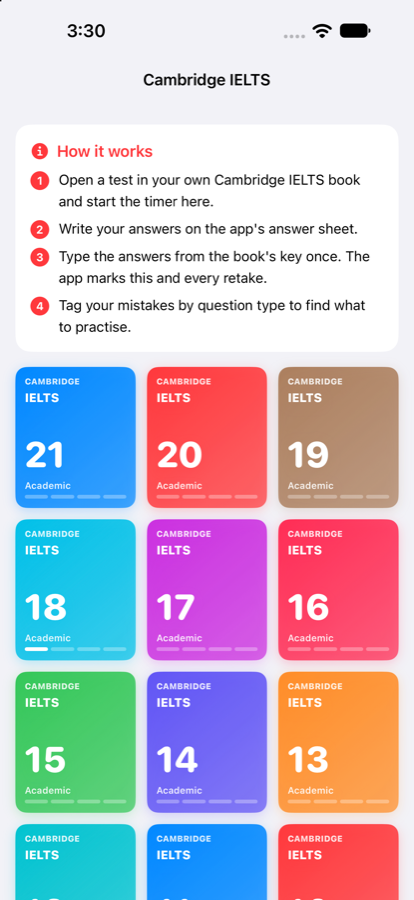 |

---

## Install on an iPhone from a Mac

**You need:** a Mac with macOS 14 or later, about 40 GB free disk space, an iPhone with iOS 17 or later,
a USB cable, and a free Apple ID.

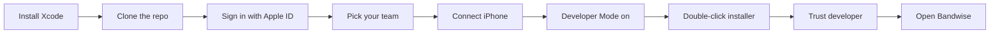

| Step | What to do |
|:---:|---|
| **1** | Install **Xcode** from the Mac App Store and open it once to finish setup. |
| **2** | Install **Git LFS** (the scoring model is stored with it): `brew install git-lfs` then `git lfs install`. No Homebrew? Download it from [git-lfs.com](https://git-lfs.com). |
| **3** | Clone the project: <br>`git clone https://github.com/isti155/bandwise-ielts.git` <br>`cd bandwise-ielts && git lfs pull` |
| **4** | Open `IELTSAssistant.xcodeproj`. In **Xcode › Settings › Accounts**, click **+** and sign in with your Apple ID. |
| **5** | Click the blue **IELTSAssistant** project → target **IELTSAssistant** → **Signing & Capabilities**. Choose your name under **Team**. If Xcode says the bundle ID is taken, change `com.isti115.ieltsassistant` to something unique, e.g. `com.yourname.bandwise`. |
| **6** | Connect the iPhone with a cable, unlock it and tap **Trust This Computer**. |
| **7** | On the iPhone: **Settings › Privacy & Security › Developer Mode › On**, then restart. After the restart, tap **Turn On** and enter your passcode. |
| **8** | Back on the Mac, double-click **`Install on iPhone.command`** in the project folder. It finds your phone, builds, installs and opens the app. (First time: if macOS blocks it, right-click › **Open** › **Open**.) |
| **9** | If the iPhone says *Untrusted Developer*: **Settings › General › VPN & Device Management** → your Apple ID → **Trust**. Open **Bandwise**. |

> **Free Apple ID limit:** apps signed with a free account stop opening after **7 days**.
> Just connect the phone and double-click the installer again — your progress is kept.
> A paid Apple Developer account ($99/year) extends this to a year and allows TestFlight.

Prefer Xcode's buttons? After step 7, choose your iPhone at the top of the Xcode window and press **▶ Run**.

---

## Install on an iPhone from Windows

Windows cannot build iPhone apps, but it can **install** one. This repo includes a GitHub Actions workflow that
builds the app on GitHub's own Mac computers and gives you an `.ipa` file. Sideloadly then installs it with your Apple ID.

**You need:** a Windows 10/11 PC, iTunes for Windows (the version from apple.com), a USB cable, a free Apple ID and a GitHub account.

| Step | What to do |
|:---:|---|
| **1** | **Fork** this repository on GitHub (button at the top right), or use your own copy. |
| **2** | In your copy, open the **Actions** tab → **Build IPA** → **Run workflow**. Wait ~10 minutes for the green tick. |
| **3** | Open the finished run and download the **Bandwise-ipa** artifact. Unzip it to get `Bandwise.ipa`. |
| **4** | Install **iTunes** for Windows from [apple.com](https://www.apple.com/itunes/) and **Sideloadly** from [sideloadly.io](https://sideloadly.io). |
| **5** | Connect the iPhone by cable, unlock it and tap **Trust** on the phone. |
| **6** | Open Sideloadly, drag in `Bandwise.ipa`, enter your Apple ID, and click **Start**. |
| **7** | On the iPhone turn on **Settings › Privacy & Security › Developer Mode** (restart, then **Turn On**). |
| **8** | **Settings › General › VPN & Device Management** → your Apple ID → **Trust**. Open **Bandwise**. |

> The same 7-day limit applies with a free Apple ID. Re-run Sideloadly with the same `.ipa` to refresh it.

---

## How it works

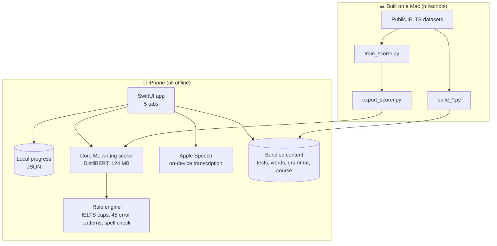

**Writing band** = the trained model's estimate → IELTS rules applied in code (under-length and missing-overview caps; overall never above the criteria mean) → whole bands per criterion, half bands overall.

**Speaking band** = speech rate, long pauses, Part 2 length and linking (fluency) + the writing model on your transcript (vocabulary, grammar) + recogniser confidence (pronunciation estimate).

**Listening and Reading** use the standard 40-question raw-score-to-band tables.

---

## Project structure

```
bandwise-ielts/
├── IELTSAssistant.xcodeproj       Xcode project (iOS 17+, iPhone)
├── IELTSAssistant/                App entry point, icon and accent colour
├── IELTSKit/                      Swift package with all logic and screens
│   ├── Package.swift
│   └── Sources/
│       ├── IELTSKit/
│       │   ├── BandScorer.swift       Tokenizer + Core ML inference
│       │   ├── LocalExaminer.swift    Writing & speaking reports
│       │   ├── WritingAnalysis.swift  Measurements and corrections
│       │   ├── GrammarCourse.swift    61-unit course model
│       │   ├── Learning.swift         XP, streaks, spaced repetition, study plan
│       │   ├── Library.swift          Content loading
│       │   ├── UI/                    All SwiftUI screens
│       │   └── Resources/             Model, tests, vocabulary, grammar, images
│       └── SelfCheck/main.swift   `swift run SelfCheck` — 150+ automated checks
├── ml/
│   ├── scripts/                   Data builders and model training
│   ├── data/                      Prepared training/validation/test essays
│   └── models/                    Trained scorer (PyTorch + Core ML package)
├── docs/                          Plan, measured accuracy, screenshots
├── .github/workflows/build-ipa.yml   Builds an .ipa for Windows users
└── Install on iPhone.command      One-click installer for Mac
```

---

## Rebuilding the data and models

Everything in `IELTSKit/Sources/IELTSKit/Resources` is generated by these scripts (Python 3.12):

```bash
# one-time environment
python3 -m venv ml/.venv
ml/.venv/bin/pip install torch transformers datasets coremltools scikit-learn pandas pyarrow pypdf cryptography nltk pillow

ml/.venv/bin/python ml/scripts/prepare_data.py           # essays + question bank
ml/.venv/bin/python ml/scripts/train_scorer.py           # train the scorer (~1 h on Apple silicon)
ml/.venv/bin/python ml/scripts/export_scorer.py          # convert to Core ML
ml/.venv/bin/python ml/scripts/build_grammar.py          # Mentors' book lessons and exercises
ml/.venv/bin/python ml/scripts/build_vocab.py            # 9,485-word dictionary
ml/.venv/bin/python ml/scripts/build_practice_content.py # reading, speaking and writing banks
```

An optional on-device language model (`ml/scripts/train_llm.py`, ~840 MB) can power free conversation replies; the app does not need it.

---

## Testing

```bash
cd IELTSKit
swift run SelfCheck
```

Checks band arithmetic, marking, every grammar and reading answer, the Core ML model against the PyTorch original, spaced repetition and the study plan.

---

## FAQ and troubleshooting

| Problem | Fix |
|---|---|
| *"Your team has no devices from which to generate a provisioning profile"* | Developer Mode is off or the phone isn't connected. Do Mac step 6–7, then run the installer again. |
| *"Untrusted Developer"* when opening | Settings › General › VPN & Device Management → Trust. |
| The app stopped opening after a week | Free Apple ID signing expired. Reinstall (Mac step 8 / Windows step 6). |
| `weight.bin` is tiny / model missing | You cloned without Git LFS. Run `git lfs install && git lfs pull`. |
| Speaking test says permission denied | Settings › Bandwise › allow Microphone and Speech Recognition. |
| Listening voices sound robotic | Settings › Accessibility › Spoken Content › Voices › English → download an *Enhanced* voice. |

---

## Data sources and credits

| Content | Source |
|---|---|
| Essay scores for training | `nlpatunt/D_Ielts_Writing_Dataset`, `chillies/IELTS-writing-task-2-evaluation`, `hai2131/IELTS-essays-task-1` (Hugging Face) |
| Reading tests | `irfanhossainsust/ielts-style-reading-passage3` (MIT, synthetic IELTS-style) |
| Task 1 visuals | `TraTacXiMuoi/Ielts_writing_task1_academic` |
| Speaking questions & transcripts | `Binhminh1210/ieltsspeaking-testbank`, `Amanafif554/IELTS-Speaking-Clean-1` |
| Vocabulary | English CEFR Wordlist (MIT), Princeton WordNet, CMU Pronouncing Dictionary |
| Grammar book | *Foundation Grammar & Writing*, Mentors' Education Series (owner's copy) |

IELTS is a registered trademark of the British Council, IDP: IELTS Australia and Cambridge University Press & Assessment.
This project is not affiliated with them. Cambridge IELTS book content is **not** included.
Some datasets and the grammar book are for personal study only — keep this repository **private**.
